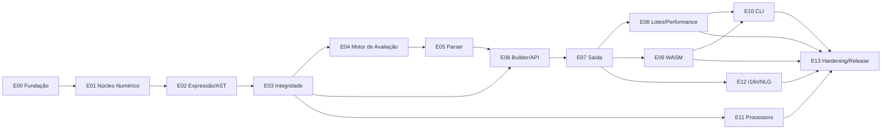

# Plano de Implementação — CalcAUY em Rust

> Plano de execução derivado dos documentos [14 — Arquitetura Oficial](../proposal/14-arquitetura-oficial-rust.md),
> [15 — Melhorias](../proposal/15-melhorias-rust-oficial.md), [11 — Preparação do Repositório](../proposal/11-preparacao-repositorio.md)
> e [12 — Performance](../proposal/10-benchmarks.md).
>
> **Objetivo do plano**: garantir que a construção do CalcAUY em Rust permaneça **consistente,
> instrumentada, rigorosa, determinística e extremamente performática** da primeira linha à release.

---

## Como este plano está organizado

- **Épicos** (`E00`–`E13`): incrementos entregáveis, cada um terminando em um **gate**.
- **Tasks** (`T##.#`): unidades sequenciais dentro do épico, cada uma com **aceite** e **evidência**.
- **Gates** (`G0`–`G13`): critérios objetivos que travam o avanço até serem satisfeitos.
- **Evidência**: artefatos versionados em `plan/evidence/` (saída de comandos, benchmarks, snapshots).

### Grafo de dependências

---

## Princípios de ordenação (por que esta ordem)

1. **Fundação primeiro (E00)**: instrumentação (`tracing`), `Clock`, `Limits`, `ProblemDetails`,
   `MetaValue` e lints existem **antes** de qualquer regra de negócio. Assim, todo incremento já
   nasce instrumentado, determinístico e rigoroso — nunca se "instrumenta depois".
2. **Núcleo numérico antes da AST (E01 → E02)**: a AST armazena `Rational` tipado; o alicerce é a
   aritmética exata provada contra o oráculo `Large`.
3. **AST antes da integridade (E02 → E03)**: a canonicalização precisa dos tipos de wire definidos.
4. **Integridade antes do commit (E03 → E04 → E06)**: o `Committed` só existe quando há assinatura.
5. **Parser antes do builder (E05 → E06)**: o builder aceita expressões textuais.
6. **Saída só depois do resultado selado (E06 → E07)**.
7. **Lotes/Performance por último no core (E08)**: só se otimiza o que já está correto, testado e
   medido — e com baselines desde E01.
8. **WASM e CLI depois das camadas estáveis (E09/E10)**: são cascas finas sobre a fachada.
9. **i18n por último (E12)**: o *seam* (SRL + trait) nasce em E07, a implementação linguística vem ao fim.
10. **Hardening/Release (E13)**: consolida corpus, fuzzing, Miri, benchmarks e publicação.

---

## Convenções de task

Cada task declara os campos abaixo.

| Campo | Descrição |
|-------|-----------|
| **ID** | `T##.#` (épico.task) |
| **Tipo** | `scaffold` · `code` · `test` · `bench` · `docs` · `ci` |
| **Depende** | task(s) pré-requisito |
| **Aceite** | critério objetivo e verificável |
| **Evidência** | comando + artefato em `plan/evidence/` |

### Definição de Pronto (DoD) — vale para toda task de código

- [ ] Compila sem warnings; `cargo clippy -- -D warnings` limpo.
- [ ] `cargo fmt --check` limpo.
- [ ] Testes unitários **in-module** + `cargo test --doc` passando.
- [ ] Propriedades/invariantes cobertas com `proptest` quando aplicável.
- [ ] Evento de instrumentação registrado no catálogo (`tracing`) se houver caminho relevante.
- [ ] Sem `unwrap`/`expect`/`panic`/`todo` (doc 11).
- [ ] Sem `unsafe` fora de `core::simd`/`core::ticks` (ADR-009).
- [ ] Determinístico sob `MockClock`; nenhum tempo/aleatoriedade no payload assinado.
- [ ] Limites (`Limits`) aplicados onde houver entrada.
- [ ] Documentação (`rustdoc` + doc tests) atualizada.
- [ ] ADR registrada se a decisão for irreversível.
- [ ] Benchmark atualizado se tocar caminho quente.

---

## Gates de qualidade (bloqueantes)

| Gate | Após | Critério |
|------|------|----------|
| **G0** | E00 | Workspace compila; CI verde (fmt/clippy/check/test/doc/deny/audit); diag+Clock+Limits+MetaValue testados |
| **G1** | E01 | Racional híbrido provado equivalente ao oráculo `Large`; limites aplicados; baselines registrados |
| **G2** | E02 | AST canônica, limitada, roundtrip de serde; acesso sequencial (bench de travessia) |
| **G3** | E03 | Assinatura determinística e versionada; custódia verificada; golden vectors; fuzz+Miri verdes |
| **G4** | E04 | Engine iterativo correto vs oráculo; memoização opcional; budgets de segurança |
| **G5** | E05 | Parser fuzzado, sem panic, com posições; diferenciais vs literal de referência |
| **G6** | E06 | Typestate completo; hibernate/hydrate íntegro; fachada `calc-auy-api` estável |
| **G7** | E07 | Todos os outputs com snapshots; seam de NLG definido |
| **G8** | E08 | Lotes multithread determinísticos; curvas de escala; `unsafe` justificado por A/B |
| **G9** | E09 | WASM publicável; Clock via host; budget de tamanho atendido |
| **G10** | E10 | CLI completa; batch em streaming com backpressure e ordem preservada |
| **G11** | E11 | Processors roundtrip conforme o schema versionado |
| **G12** | E12 | Locales com snapshots; ordem/concordância corretas |
| **G13** | E13 | Release: corpus, fuzz, Miri, deny, semver-checks, docs e publicação |

---

## Evidência e rastreabilidade

- `plan/evidence/E##/T##.txt` — saída de comandos (testes, clippy, bench).
- `plan/evidence/E##/T##.bench.json` — resultados `criterion`.
- `plan/evidence/G##.md` — ata do gate: o que foi verificado e resultado.
- Cada épico lista os **ADRs** e **docs** que implementa.

## Orçamentos de performance (metas por camada)

| Camada | Métrica-alvo | Origem |
|--------|--------------|--------|
| `Small` add/mul | dezenas de ns/op (sem heap) | doc 12 |
| `Large` bignum | µs–ms conforme bits | doc 12 |
| Canonical + sign | caminho frio, ≤ ~100 µs típico | doc 10 |
| Parser | < 1 ms para expressões usuais | doc 10 |
| Lote | throughput escala ~linear com núcleos; trabalho por tile na L1/L2 | ADR-010 |

---

## Índice de épicos

| Épico | Arquivo | Entrega |
|-------|---------|---------|
| E00 | [E00-fundacao.md](./E00-fundacao.md) | Workspace, lints, CI, diag, Clock, Limits, erros, MetaValue |
| E01 | [E01-nucleo-numerico.md](./E01-nucleo-numerico.md) | Racional híbrido, backend, gcd, pow, rounding, parse |
| E02 | [E02-expressao-ast.md](./E02-expressao-ast.md) | `FlatAst`, tipos, flattening, serde, limites |
| E03 | [E03-integridade.md](./E03-integridade.md) | Canonical derive, Digest, sign keyed, custódia, hashes |
| E04 | [E04-motor-avaliacao.md](./E04-motor-avaliacao.md) | Eval iterativo, commit, memoização |
| E05 | [E05-parser.md](./E05-parser.md) | Lexer zero-copy, parser, fuzz |
| E06 | [E06-builder-api.md](./E06-builder-api.md) | Typestate, fluent API, hibernate/hydrate, fachada |
| E07 | [E07-saida.md](./E07-saida.md) | Outputs + seam NLG |
| E08 | [E08-lotes-performance.md](./E08-lotes-performance.md) | SoA, tiles, rayon, unsafe A/B, PGO |
| E09 | [E09-wasm.md](./E09-wasm.md) | `calc-auy-wasm`, bindings, CI wasm |
| E10 | [E10-cli.md](./E10-cli.md) | Binário `calc-auy`, batch streaming |
| E11 | [E11-processors.md](./E11-processors.md) | Protobuf/CBOR/MsgPack do schema |
| E12 | [E12-i18n-nlg.md](./E12-i18n-nlg.md) | SRL + realizers por idioma |
| E13 | [E13-hardening-release.md](./E13-hardening-release.md) | Corpus, fuzz, Miri, benchmarks, publicação |
